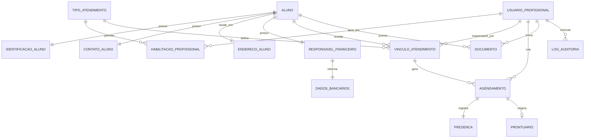

# Modelagem do banco de dados

Este documento apresenta a modelagem do banco para o Sistema Web do Espaço Bianca Petenão em três fases: projeto conceitual, projeto lógico e projeto físico. O escopo cobre cadastro de usuários e profissionais, alunos, responsável financeiro, agenda, presença, documentos, prontuários e auditoria.

## 1. Projeto conceitual - DER

O modelo conceitual representa as entidades do negócio e seus relacionamentos, sem detalhes de implementação. As entidades de identificação, contato, endereço e dados financeiros são separadas para reduzir a exposição de dados pessoais e facilitar as regras de acesso da LGPD.



### Regras de negócio representadas

- Um aluno possui um responsável financeiro e um único endereço cadastrado no MVP.
- Um profissional só pode ser responsável por um tipo de atendimento para o qual esteja habilitado.
- Um aluno pode ter mais de um vínculo de atendimento, inclusive com profissionais ou serviços diferentes.
- Cada agendamento pertence a um vínculo de atendimento e possui um único registro de presença.
- O valor é gravado no agendamento para preservar o histórico caso o preço do serviço mude.
- O lembrete pode ter como destinatário o aluno ou o responsável financeiro.

## 2. Projeto lógico

O projeto lógico converte as entidades em tabelas, define chaves e resolve os relacionamentos muitos-para-muitos.

| Tabela | Chave primária | Chaves estrangeiras e finalidade |
|---|---|---|
| `profiles` | `id` | Referencia `auth.users`; armazena usuário, profissional, perfil (`admin` ou `user`) e especialidade. |
| `service_types` | `id` | Catálogo de tipos, preço padrão e duração padrão. |
| `professional_service_types` | `professional_id`, `service_type_id` | Resolve N:N entre profissional e tipo de atendimento. |
| `students` | `id` | Dados mínimos do aluno: nome, nascimento e início dos atendimentos. |
| `student_identifiers` | `student_id` | CPF, RG e CNS do aluno. |
| `student_contacts` | `student_id` | E-mail e telefone do aluno. |
| `student_addresses` | `student_id` | Endereço do aluno. |
| `financial_responsibles` | `id` | Responsável financeiro vinculado a um aluno. |
| `financial_responsible_bank_accounts` | `financial_responsible_id` | Dados bancários do responsável financeiro. |
| `student_service_assignments` | `id` | Vínculo aluno + profissional + tipo de atendimento. |
| `appointments` | `id` | Agenda, valor aplicado, situação e destinatário do lembrete. |
| `attendance` | `appointment_id` | Presença, falta ou cancelamento da consulta. |
| `session_records` | `appointment_id` | Prontuário de um atendimento. |
| `student_documents` | `id` | Metadados de arquivos privados, como contrato e laudo. |
| `audit_logs` | `id` | Rastreabilidade de mudanças relevantes. |

### Campos obrigatórios do cadastro

| Cadastro | Campos obrigatórios |
|---|---|
| Usuário/profissional | Nome completo, e-mail, telefone, CPF, especialidade e perfil. |
| Aluno | Nome completo, data de nascimento, início dos atendimentos, CPF e RG. |
| Endereço | Rua, número, bairro, cidade e estado. |
| Responsável financeiro | Nome, CPF, telefone, e-mail, estado civil, naturalidade, ocupação, remuneração e valor/hora. |
| Dados bancários | Banco, agência, conta corrente e chave Pix. |
| Atendimento | Tipo de atendimento, profissional responsável, valor, data/hora e destinatário do lembrete. |

## 3. Projeto físico

O projeto físico descreve como o banco PostgreSQL será implementado no Supabase.

### Convenções técnicas

- Chaves primárias usam `uuid` com `gen_random_uuid()`; a exceção é `audit_logs`, que usa identidade numérica.
- Valores monetários usam `numeric(12,2)`, evitando imprecisão de ponto flutuante.
- Campos de situação usam `enum`: `app_role`, `appointment_status`, `attendance_status`, `reminder_recipient` e `document_kind`.
- Datas de criação e atualização usam `timestamptz` e gatilhos para atualizar `updated_at`.
- CPF, e-mail de usuário e caminhos de documentos possuem restrições de unicidade quando aplicável.
- O índice `appointments_assignment_starts_at_idx` otimiza a agenda por vínculo e horário.

### Segurança e LGPD no banco

| Recurso | Implementação |
|---|---|
| Autenticação | Supabase Auth em `auth.users`; `profiles.id` referencia esse usuário. |
| Autorização | RLS habilitada em todas as tabelas da aplicação. |
| Exposição da API | Sem exposição automática: a migration concede apenas leitura de agenda e a RPC de presença ao usuário autenticado. |
| Administrador | Pode gerir cadastros, dados financeiros, documentos, relatórios e logs. |
| Usuário comum | Vê apenas a própria agenda, alunos vinculados e presença dos seus atendimentos. |
| Dados sensíveis | Identificadores, contatos, endereço, dados financeiros e bancários ficam em tabelas separadas e somente administradores os consultam. |
| Presença | A função `record_attendance(...)` limita o usuário comum a registrar presença, falta ou cancelamento somente no próprio atendimento. |
| Documentos | Bucket privado `student-documents`; sem URLs públicas. |
| Auditoria | Gatilhos registram ator, operação, entidade e campos alterados, sem replicar conteúdo de prontuários ou arquivos. |

### Artefato de implementação

A definição SQL está em:

`backend/supabase/migrations/20261105000000_initial_schema.sql`

Para aplicar depois que o projeto Supabase estiver conectado:

```bash
supabase --workdir backend db push
```

Antes do primeiro deploy, é necessário cadastrar o primeiro administrador usando uma operação administrativa segura, pois as políticas RLS impedem que um usuário comum eleve o próprio perfil.

Operações administrativas são executadas pelo backend com a chave secreta armazenada no ambiente do servidor. Essa chave nunca deve ser enviada ao frontend ou incluída no repositório.
